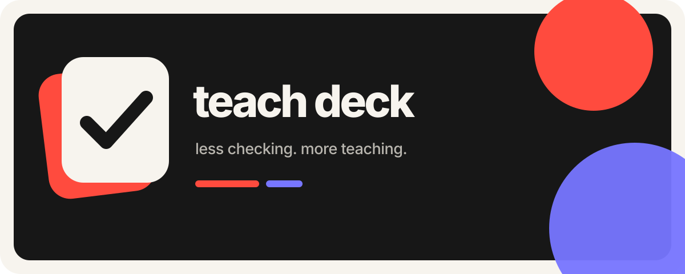

  

## Инструменты, которые возвращают учителю время

Teach Deck создаёт спокойный и управляемый учителем процесс проверки рукописных работ. Система читает то, что фактически написал ученик, применяет ключ или критерии учителя и возвращает каждое спорное решение на ручную проверку.

### Что для нас важно

| Честное чтение | Контроль учителя | Защита данных |
| --- | --- | --- |
| Сохраняем ошибки ученика, а не исправляем их незаметно. | Система предлагает, учитель принимает решение. | Личность ученика не участвует в процессе проверки. |

### Что мы создаём первым

- пакетную загрузку рукописных работ с телефона и из PDF;
- дословную транскрипцию с отметками неуверенности;
- детерминированную проверку упражнений по ключу;
- рекомендательную проверку заданий 37 и 38 ЕГЭ;
- измерение точности, сэкономленного времени и стоимости обработки.

> **Меньше проверки. Больше преподавания.**
