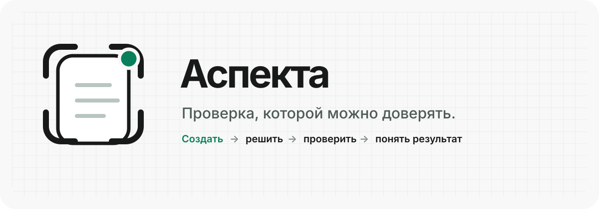

  

## Образовательная платформа для учителей и учеников

**Аспекта** объединяет создание заданий, самостоятельную работу ученика и прозрачную экспертную проверку. Система объясняет предложения, показывает основания каждого вывода и возвращает человеку решения, которые требуют подтверждения.

> **Проверка, которой можно доверять.**

### Как устроен продукт

**Создать → решить → проверить → понять результат.**

| Учителю | Ученику | Организации |
| --- | --- | --- |
| Создавать и переиспользовать задания, собирать работы, проверять выводы системы и видеть прогресс. | Выполнять задания и квизы, отправлять работы и получать понятный результат с объяснениями. | Управлять каталогом, участниками, учебными группами и использованием платформы. |

### Наши принципы

- **Человек принимает решение.** Система предлагает чтение, замечание или балл; учитель подтверждает итог.
- **Каждый вывод объясним.** Замечание связано с конкретным фрагментом, критерием и этапом обработки.
- **Неопределённость видима.** Если текст прочитан неуверенно, анализ останавливается до подтверждения или замены материала.
- **Один продукт для полного цикла.** От конструктора задания и решения ученика до проверки и анализа прогресса.
- **Спокойный профессиональный интерфейс.** Без «магии ИИ», тревожного потока уведомлений и скрытых автоматических решений.

### Что мы разрабатываем сейчас

- загрузку и группировку многостраничных работ;
- подтверждение распознавания до запуска анализа;
- проверку по критериям с привязанными к фрагментам замечаниями;
- редактируемые маршруты обработки и повторный запуск зависимых этапов;
- каталоги заданий, кабинеты учителя и ученика;
- измерение качества, времени и стоимости обработки.

Техническое имя организации остаётся `teach-deck`, а публичное имя продукта — **Аспекта / Aspekta**.
